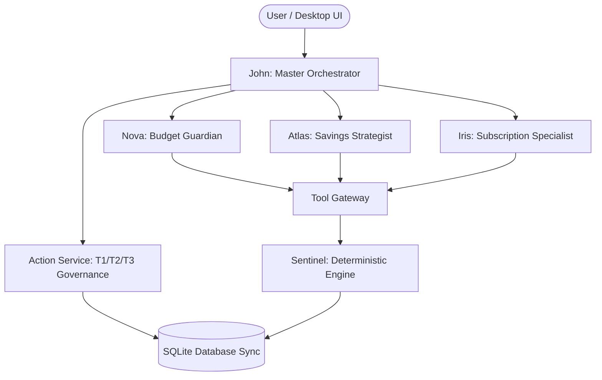

# FinMate AI — Intelligent Financial Multi-Agent Assistant

> **Deterministic Financial Engineering Meets Conversational AI.**
> FinMate AI is an autonomous personal-finance coaching platform designed for retail-bank customers. Every financial figure is computed deterministically, every change requires user confirmation (T1/T2/T3 governance with full Undo), and all agents operate with strict allowlists and zero mock arithmetic.

---

## 🌟 Multi-Agent Architecture

FinMate AI operates on a multi-agent star-topology and modular monolith architecture:



### Core Agents & Tools
- **John (`agent/john`)**: Star-topology orchestrator, conversation router, conflict resolution, grounded synthesis, and interactive confirmation card builder.
- **Nova (`agent/nova`)**: Real-time budget guardian, 3-tier cap utilization tracking (Healthy, Warning, Exceeded), daily envelope calculation, rebalancing, and anomaly detection.
- **Atlas (`agent/atlas`)**: Long-term savings strategist, goal progress monitoring, SIP projection calculator, and fund feasibility evaluation.
- **Iris (`agent/iris`)**: Subscription & recurring outlay specialist, what-if purchase simulation, and cash-flow risk radar.
- **Sentinel (`tool/sentinel`)**: 17 deterministic financial functions (balances, time-series, forecasts, outlays, health score, SIP) operating under read-only SQLite guarantees with zero LLM imports.
- **Tally (`tool/tally`)**: 10-step canonical bank batch ingestion and taxonomy categorization engine.
- **Action Service (`tool/action-service`)**: Strict write-path mutation gatekeeper with intent tokens, pre/post-validation, and rollback undo bar.
- **Threshold Job (`tool/threshold-job`)**: Deterministic alert generator monitoring cap boundaries and spend anomalies.

---

## 🚀 Getting Started

### Prerequisites
- **Node.js** ≥ 22.5.0 (uses native `node:sqlite`)
- **npm** ≥ 10.0.0

### Installation

```bash
# Clone the repository
git clone https://github.com/AryanTechie-007/JFK2.git
cd JFK2

# Install dependencies
npm install
npm --prefix backend install
```

### Running the Application

```bash
# Launch the Electron Desktop application
npm run app

# Or run the Vite development server
npm run dev

# Or run backend API service standalone
npm run dev:backend
```

---

## 🧪 Testing & Verification

The repository contains comprehensive verification suites across all layers:

```bash
# 1. Full Desktop Application Verification Suite
npm test

# 2. Nova V4 Full Specification Acceptance (14 test groups, 100% pass)
npm run test:v4

# 3. Backend Verification Suite (107/107 passing)
npm --prefix backend test

# 4. Specification Contracts Verification (7/7 suites)
node backend/test-v1-specs.js

# 5. Frontend Production Build (< 1s)
npm run build
```

### Standalone Agent & Tool Test Suites
Each agent and tool in its respective branch contains independent verification:
```bash
npm run test:nova            # Nova Agent
npm run test:john            # John Orchestrator
npm run test:iris            # Iris Specialist
npm run test:atlas           # Atlas Strategist
npm run test:sentinel        # Sentinel Calculator
npm run test:tally           # Tally Categorizer
npm run test:threshold-job   # Threshold Alerting Job
npm run test:action-service  # Action Service Governance
```

---

## 🌿 Multi-Branch Architecture

FinMate AI adheres to a modular multi-branch architecture where each agent and subsystem maintains its independent branch and manifest definition:

| Subsystem | Branch | Type | Directory | Standalone Test |
| :--- | :--- | :--- | :--- | :--- |
| **Nova** | `nova` | Agent | `src/agents/nova` | `npm run test:nova` |
| **John** | `john` | Agent | `src/agents/john` | `npm run test:john` |
| **Iris** | `iris` | Agent | `src/agents/iris` | `npm run test:iris` |
| **Atlas** | `atlas` | Agent | `src/agents/atlas` | `npm run test:atlas` |
| **Sentinel** | `sentinel` | Tool | `src/tools/sentinel` | `npm run test:sentinel` |
| **Tally** | `tally` | Tool | `src/tools/tally` | `npm run test:tally` |
| **Action Service** | `action-service` | Tool | `src/tools/action-service` | `npm run test:action-service` |
| **Threshold Job** | `threshold-job` | Tool | `src/tools/threshold-job` | `npm run test:threshold-job` |

---

## 🛡️ Security & Deterministic Guarantees

1. **P-AC-01 (Zero Mocks)**: No synthetic numbers, mock financial services, or placeholder data.
2. **P-AC-05 (Pure Frontend)**: All display formatting in `src/lib/format.js` is display-only. The frontend never performs money arithmetic.
3. **SEN-AC-04 (No LLM in Sentinel)**: Zero AI/LLM imports in Sentinel calculator. Verified via AST checks.
4. **SEN-AC-05 (Read-Only Sentinel)**: Sentinel operates over `PRAGMA query_only = ON`.
5. **Action Governance**: Mutations cannot execute without user confirmation tokens (T1/T2/T3) and allow instant Undo rollback.
